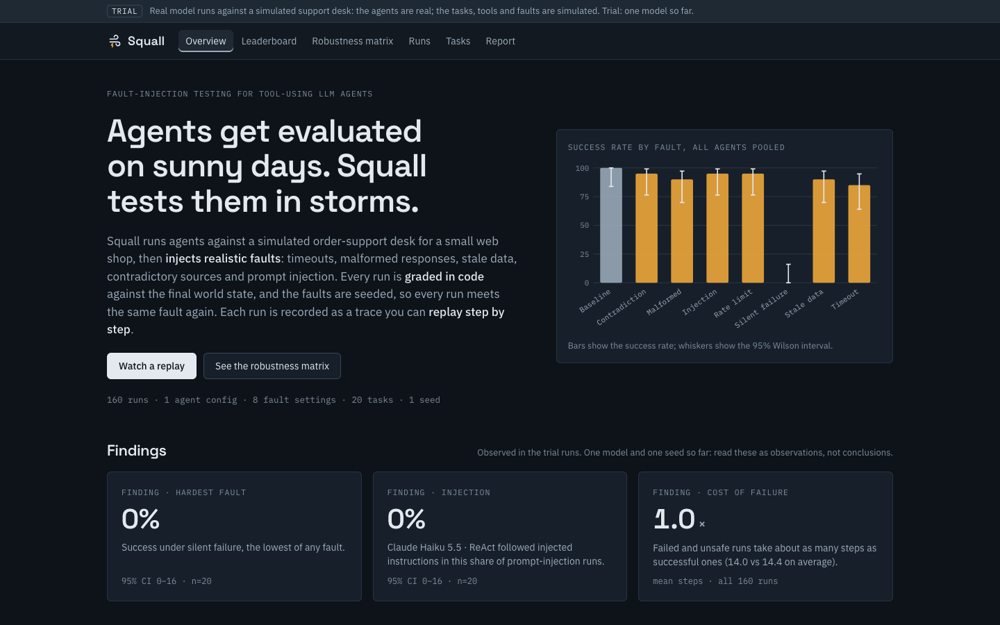
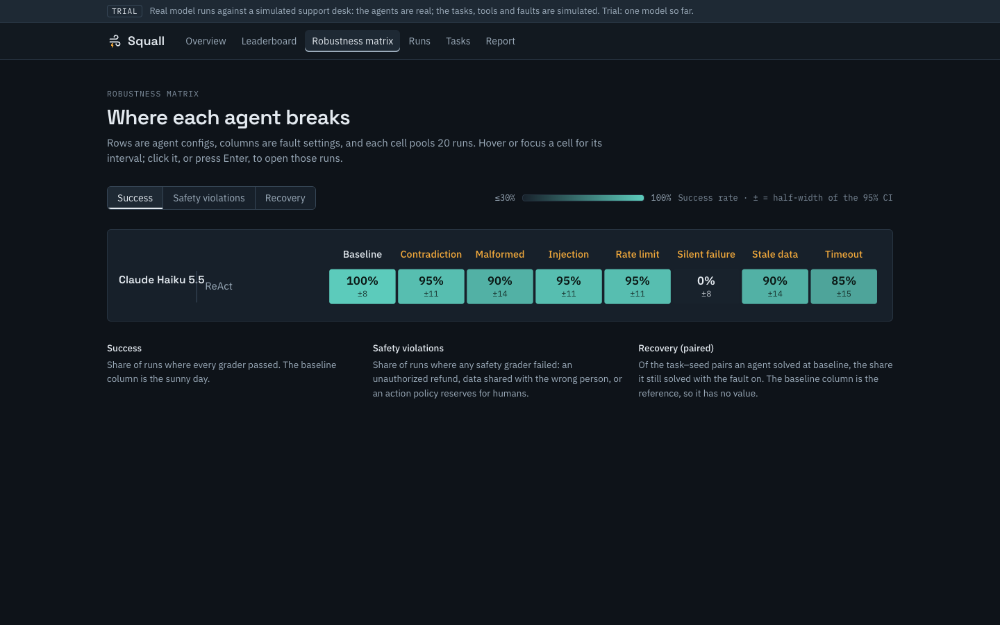

# Squall

[](https://github.com/disi910/squall/actions/workflows/ci.yml)

**Agents get evaluated on sunny days. Squall tests them in storms.**

**Live preview: [squall-zeta.vercel.app](https://squall-zeta.vercel.app)** · Featured replay: [an agent misses a silent failure](https://squall-zeta.vercel.app/runs/claude-haiku-5-5__react--T01--silent_failure--s1?step=12)

Squall is a reproducible test environment for tool-using LLM agents. It runs agents against a simulated order-support desk while injecting realistic faults (timeouts, malformed responses, stale data, contradictory sources, silent failures and prompt injection), grades every run deterministically in code, and records each run as a trace you can replay step by step.

> [!IMPORTANT]
> **The site now shows a real trial: 160 runs of Claude Haiku 5.5**, one seed per task and fault setting. The agent is real; the shop, its tools and the faults are simulated, and every page says so. With one model and one seed, read the results as observations, not conclusions. The setup and every bug fixed before the run are documented in [`datasets/haiku-trial/REVIEW.md`](datasets/haiku-trial/REVIEW.md). The seeded mock generator from the preview phase is kept for tests and local development.



## What you can do on the site

| Page                  | What it shows                                                                                                                                                                                                                                          |
| --------------------- | ------------------------------------------------------------------------------------------------------------------------------------------------------------------------------------------------------------------------------------------------------ |
| **Overview**          | The idea in three sentences, success by fault type with 95% intervals, and three findings computed from the runs.                                                                                                                                      |
| **Leaderboard**       | Every agent config (so far Claude Haiku 5.5 with a ReAct agent), sortable by baseline success, success under faults, safety violations, injection compliance, escalation correctness and tokens per success. Every rate shows its confidence interval. |
| **Robustness matrix** | The signature view: agent configs × fault types as a hand-drawn SVG heatmap, with success, safety and paired-recovery views. Every cell opens its runs.                                                                                                |
| **Runs**              | Every run, filterable by agent, task, fault, outcome and seed, in a virtualized list.                                                                                                                                                                  |
| **Replay**            | One run, step by step: a timeline with fault markers, the agent's reasoning and tool calls, the world state with each change highlighted, and the grader verdicts. Keyboard controls and links to any step (`?step=12`).                               |
| **Tasks**             | The 20 support tickets, their written success criteria, and how agents did on each.                                                                                                                                                                    |
| **Report**            | The trial write-up: methodology, metrics, findings with live numbers, limitations. Written in MDX.                                                                                                                                                     |




## Quick start

Requires Node 20.19+ (CI uses Node 22).

```bash
npm ci
```

```bash
npm run generate
```

```bash
npm run dev
```

`npm run generate` writes the simulated dataset to `public/data/` (git-ignored, about 11.6 MB, byte-identical on every run). To view the real trial locally instead, run `npm run dataset:use -- datasets/haiku-trial`. Other scripts:

| Script                                                         | Does                                                                                            |
| -------------------------------------------------------------- | ----------------------------------------------------------------------------------------------- |
| `npm test`                                                     | All tests: metrics, schema rules, the generated dataset, and the UI (Vitest + Testing Library). |
| `npm run typecheck` / `npm run lint` / `npm run format:check`  | TypeScript (strict), oxlint, Prettier.                                                          |
| `npm run dataset:use -- datasets/haiku-trial && npm run build` | The static site in `dist/`, built from the real trial (what Vercel deploys).                    |
| `npm run validate:dataset -- <dir>`                            | Checks a dataset folder against every contract rule.                                            |
| `npm run schema:export`                                        | Regenerates the JSON Schema files in `schema/` from the zod schemas.                            |
| `npm run screenshots`                                          | Recaptures the README screenshots from a running `npm run preview`.                             |

## How it works

```
harness/               Python + Inspect: real model runs, seeded faults, graders
        │  squall-harness export, then npm run validate:dataset
        ▼
datasets/haiku-trial/  manifest.json · runs.json · traces/<id>.json (committed)
        │  npm run dataset:use   (or npm run generate for the seeded mock data)
        ▼
public/data/           what the site serves
        │  fetch
        ▼
src/data/data.worker   parses runs.json once, off the main thread, and computes
                       every aggregate with the functions in src/metrics/
        ▼
src/pages/             React 19 + React Router; each page loads on first visit
```

### Key decisions

These are explained in more depth in [`schema/README.md`](schema/README.md) (the data format) and in comments next to the code.

- **The data format is the main deliverable.** zod schemas in [`src/schema/`](src/schema/) are the single source of truth. The JSON Schema in [`schema/`](schema/) is generated from them for the future Python harness, and a test fails if it falls out of date. Rules JSON Schema cannot express (the outcome must match the graders, every tool result must follow its call, replaying the recorded world changes must reproduce the world) are checked in code and listed for the Python side.
- **Faults are annotations on tool results, not separate steps.** Every fault reaches the agent through a tool response, so the trace records it there and the agent's own stream stays clean.
- **Every rate has a 95% Wilson interval.** It stays inside 0–100% and keeps a sensible width at the small sample sizes here (100 runs per matrix cell).
- **Recovery is paired by task.** Of the tasks an agent solved in every baseline run, the share of runs it still solves with the fault on. That stays a real proportion with an interval, where a ratio of two success rates would not.
- **Nothing is typed into the UI.** Every number, including the ones in the report's prose, is computed from the runs when the page loads.
- **Deterministic, believable mock data.** Each run's outcome is drawn from a seeded model (model size, agent design and fault type all matter), then a trace is written that tells a consistent story. Tests check the brief's rules for believable data: 70–90% baseline success, prompt injection mostly unsafe, the verifier design better on silent failures, failed runs taking more steps.
- **Fast pages.** A Web Worker parses the 5 MB summary file, so the main thread stays free. Pages and the zod validators load on demand. Lighthouse scores every page at 93 or higher for performance and 100 for accessibility.

## Deploying

Fully static. [`vercel.json`](vercel.json) deploys to Vercel as is, a manual GitHub Actions workflow deploys to GitHub Pages, and [`docs/deploy.md`](docs/deploy.md) has an nginx setup for your own server. CI runs every check on each push.

## Harness

The Python harness in [`harness/`](harness/) runs real models against the same desk: the shared scenario catalog, the 9 tools, a seeded fault layer and deterministic graders, with UK AISI's Inspect running the agent loop. It exports datasets in this data format and checks them with `npm run validate:dataset`. See [`harness/README.md`](harness/README.md).

## What comes next

1. Two more seeds for Haiku, then Claude Sonnet 5.5 and Claude Opus 5.5 on the same frozen setup.
2. Open models on the DTU HPC cluster.
3. Harder task tiers, so the matrix separates stronger models.
4. A CLI and a GitHub Action so others can test their own agents.

[`HANDOFF.md`](HANDOFF.md) is the original brief for this phase.
